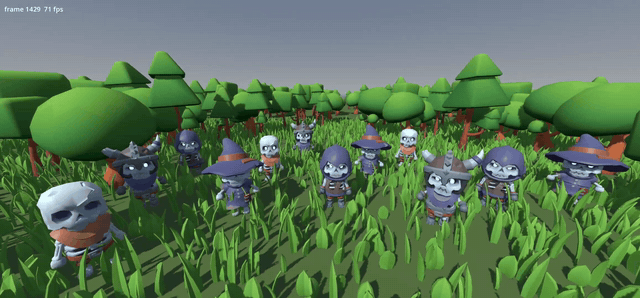
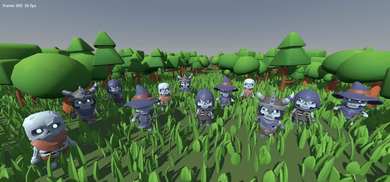

# Adreno 730: single-frame glitches with GPU composition (Godot 4.7.2, Vulkan)

Minimal reproduction project for a Godot bug report.

On an Adreno 730 phone, the Forward Mobile renderer (Vulkan) shows single-frame glitches whenever Android
composites the screen on the GPU, for example with "Disable HW overlays" enabled or during a screen recording.
The same project on the Compatibility renderer (OpenGL ES 3.2) has no glitches.

*Phone recordings slowed down to 5 fps. The glitch is the middle frame of each loop.*

## Tested on

- Samsung Galaxy S22 Ultra (SM-S908E), Adreno 730, Vulkan driver 512.615.98, Android 16
- Godot 4.7.2-stable, official editor and export templates

## Steps to reproduce

1. Open the project in Godot 4.7.2 and export the "Android Vulkan" preset.
2. On the phone, enable Developer options > "Disable HW overlays" (it resets on reboot).
3. Run the app for a minute. The camera is static and a frame counter is in the top-left corner.

Expected: no glitches. Actual: frequent single-frame glitches of three kinds:

- the ground and grass are missing and the clear colour shows through
- wrong shadows on the grass
- one skinned mesh is drawn as giant stretched spikes

The "Android Compatibility" preset is the same project on OpenGL (`gl_compatibility`), as a control.

## Results

90 s per run, recorded with scrcpy (which also forces GPU composition), no input:

| Build | fps | Frames | Frames with missing ground | Single-frame glitches (any kind) |
|---|---|---|---|---|
| Forward Mobile (Vulkan) | 71 | 6082 | 158 (2.6 %) | 549, some are false positives |
| Forward Mobile (Vulkan), 30 fps cap | 30 | 2695 | 0 | 1 |
| Compatibility (OpenGL ES 3.2) | 40 | 3723 | 0 | 0 |

With "Disable HW overlays" off, I saw no clear glitch by eye. This case can't be recorded, because any recording
forces GPU composition.

The rate depends on GPU load. The scene has 12 skinned characters, 6000 grass and 300 tree instances with a
vertex wind shader, a DirectionalLight3D with shadows, 3D scale 2.0 and MSAA 2x. There is no fps cap: V-Sync is
on, and the app runs at about 71 fps on the 120 Hz screen.

## Likely cause

The Vulkan queue global priority (`VK_EXT_global_priority`) changes the rate. LOW makes it much worse (11.7 % of
frames in the game where I found this). HIGH removes it in this project (0 of 2084 frames). So the driver seems to
lose part of a frame when the compositor's GPU work preempts the app.

The engine patch for that test is in [`fix/`](fix/README.md), with its cost. It is not proposed as a PR.

## Files

- `main.tscn`, `main.gd`, `wind.gdshader`: the scene.
- [`tools/`](tools/README.md): scripts to record the phone screen and count glitch frames.
- [`evidence/`](evidence/README.md): clips and frame strips from this project and from the original game.
- [`fix/`](fix/README.md): the queue priority patch.

## AI disclosure

This project, the scripts and the READMEs were written with an AI assistant (Claude). I ran all tests on my
phone and checked the results.

## License

MIT (`LICENSE`). The models in `assets/` are KayKit by Kay Lousberg, CC0 (`assets/KayKit-CC0-License.txt`).
